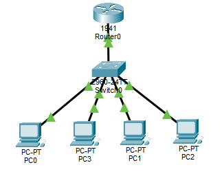
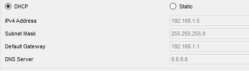
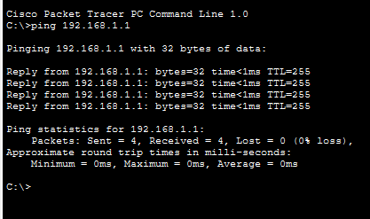

Small Office Network Design

This is my first networking project, which I created using Cisco Packet Tracer.

In this project, I designed a small office network using routers, switches and PCs. I configured IP addresses, subnetting and DHCP, and tested the network connectivity using ping commands.

 Tools and Technologies

- Cisco Packet Tracer
- Router and Switch
- PCs
- IPv4
- Subnetting
- DHCP

 What I Did

- Created a small office network.
- Connected PCs, switches and routers.
- Configured IP addresses.
- Set up DHCP for automatic IP assignment.
- Tested connectivity using ping.
 Screenshots

 Network Topology

 

 
 DHCP Configuration

 
 Ping Test

 What I Learned

While working on this project, I learned how to create a basic network, configure IP addresses, use DHCP and test connectivity between devices.

 Author

Syed Jibran Bukhari

